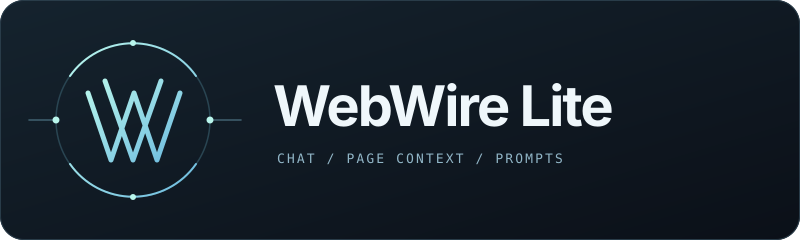
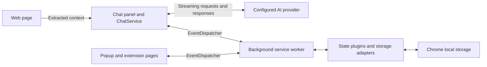

<p align="center">
  
</p>

<h1 align="center">WebWire Lite</h1>

<p align="center">
  <strong>Chat with the page you're reading.</strong><br>
  A Chrome extension with reusable prompts and saved conversations.
</p>

<p align="center">
  <a href="#installation">Installation</a> •
  <a href="#usage">Usage</a> •
  <a href="#features">Features</a> •
  <a href="#how-it-works">How It Works</a> •
  <a href="#troubleshooting">Troubleshooting</a>
</p>

## What is WebWire Lite?

WebWire Lite is a Chrome extension that puts an AI chat panel alongside the page you're reading. Ask questions about an article, turn documentation into study notes, or extract the useful details from a long page. It combines page context, conversation history, and reusable prompts with the model provider you configure.

Built for Chrome with Manifest V3, WebWire Lite keeps your conversations and preferences in your browser and connects directly to your chosen AI provider.

## Features

- **Page-aware conversations** — Include extracted page content in your questions and see responses stream into an embedded chat panel.
- **Bring your own model** — Provider clients for OpenAI, Google AI Studio, and Featherless, plus OpenAI-compatible routes such as OpenRouter, Groq, and a configurable local endpoint.
- **Reusable prompts** — Bundled prompts for summaries, research, study notes, and other tasks; create, edit, reorder, import, and export your own.
- **Conversation history** — Browse saved threads, inspect messages, and manage previous conversations from a dedicated page.
- **Control the context** — Choose whether to include the page, customize system prompts, and configure model sampling and token limits.
- **Read responses aloud** — Browser speech synthesis with configurable voice, language, rate, and pitch.

## Installation

### Build from source

You'll need Git, Node.js with npm, and Chrome. The extension calls your configured model provider directly, so have an API key or a compatible local inference endpoint available.

```bash
git clone https://github.com/54rt1n/webwire.git
cd webwire
npm install
npm run build:lite
```

### Load into Chrome

1. Open `chrome://extensions` and enable **Developer mode**.
2. Choose **Load unpacked** and select `dist-lite/`.
3. Pin WebWire from Chrome's extensions menu.
4. Open **Settings** in the WebWire popup to configure your model.

The build creates `dist-lite/` with bundled scripts, assets, and the extension manifest.

## Usage

### Configure a provider

1. In **Settings → Provider Settings**, enter the API key for your chosen provider. For a local provider, also enter its OpenAI-compatible API base URL.
2. Under **Model Configuration → Chat Model (Primary)**, select the matching provider and enter a model identifier available from that provider.
3. Adjust the response and content token limits as needed, then click **Save All Settings**.

Use the model identifier supplied by your provider. Local endpoints use the OpenAI-compatible chat completions format.

### Chat with a page

Open a web page, click the WebWire icon, and turn on **Assistant**. Keep page content enabled to ask about what you're reading, or turn it off for a conversation without that context.

Try a question such as:

> Summarize this page in five bullets, then list the claims I should verify.

> Explain the API described here and give me a minimal usage example.

Use **Prompts** in the popup to manage reusable instructions and **Conversations** to revisit saved threads. **Help** opens the bundled setup guide.

Toggle the panel with **Ctrl+Shift+W** on Windows/Linux or **Command+Shift+W** on macOS. Set your preferred shortcut at `chrome://extensions/shortcuts`.

## How It Works



1. A content script initializes the application and injects the chat panel into the page.
2. The chat service combines your message with enabled page context, prompts, and conversation history.
3. The selected provider client sends the request and streams the response back to the panel.
4. An event dispatcher routes state operations between extension contexts; the background worker coordinates persistence and tab state.

## Technical Details

### Project layout

| Path | Responsibility |
| --- | --- |
| [`app-lite/`](app-lite/) | Extension entry points and manifest template |
| [`src/content/`](src/content/) · [`src/background/`](src/background/) | Page host and background service worker |
| [`src/chat/`](src/chat/) | Chat orchestration, streaming, and rendering |
| [`src/js/ai/`](src/js/ai/) | Provider factory and AI clients |
| [`src/js/core/`](src/js/core/) · [`src/js/context/`](src/js/context/) | Configuration, events, and service initialization |
| [`src/js/state/`](src/js/state/) · [`src/js/storage/`](src/js/storage/) | Domain state plugins and persistence adapters |
| [`assets/prompts/`](assets/prompts/) | Bundled prompt templates |
| [`tests/`](tests/) | Vitest unit and integration tests |

The application uses JavaScript ES modules and SCSS, bundled with Webpack. `EventBus` handles communication within a context; `EventDispatcher` carries messages across extension contexts. Runtime dependencies include `js-tiktoken` for tokenization and `@sentry/browser` for optional crash reporting.

### Data and permissions

Settings and conversation state use `chrome.storage.local` in the extension. Model requests send messages and enabled context to the provider you select. Page content is enabled by default for new tab state and can be disabled in the panel.

The manifest requests `activeTab`, `storage`, and `scripting`, along with HTTP/HTTPS host access and content scripts on matching pages. Crash reporting is disabled in the initial user settings and can be enabled in Options.

### Development

```bash
# Rebuild as you edit
npm run dev:lite

# Run tests once, or keep Vitest watching
npm test -- --run
npm test

# Generate coverage
npm run test:coverage -- --run

# Package an already-built extension (requires zip)
npm run package:lite
```

After rebuilding, reload the extension at `chrome://extensions` and refresh the page you're testing. The package command creates `webwire-lite.zip` at the repository root.

Read the applicable `CLAUDE.md` files before contributing. Build scripts live in [`package.json`](package.json), and [`webpack.multi.config.cjs`](webpack.multi.config.cjs) defines the extension bundles.

## Troubleshooting

| Problem | What to check |
| --- | --- |
| Chrome cannot load the extension | Select `dist-lite/` after a successful build and confirm it contains `manifest.json`. |
| The assistant does not appear | Enable **Assistant** in the popup, refresh the tab after extension reloads, and test on a regular HTTP/HTTPS page.  |
| The popup reports an unconfigured client | Save the provider API key, model identifier, and matching model provider in Settings. |
| The provider rejects a request | Check the key, model access, endpoint, and sampling parameters. |
| A local endpoint fails from an HTTPS page | Check its HTTPS configuration, CORS policy, and browser console errors. See the local-model section of the bundled setup guide. |
| The keyboard shortcut does not toggle the panel | Assign an available combination at `chrome://extensions/shortcuts`, or use the popup toggle. |

For diagnostics, inspect the page's DevTools console and the extension's **service worker** console at `chrome://extensions`.

## Contributing

Issues and pull requests are welcome. Include reproduction steps and relevant console output in bug reports. For code changes, run the relevant tests and describe any browser checks you performed.

## License

[PolyForm Noncommercial License 1.0.0](LICENSE.md).

Required Notice: Copyright (c) 2025 Martin Bukowski

## Author

[Martin Bukowski](https://github.com/54rt1n)
